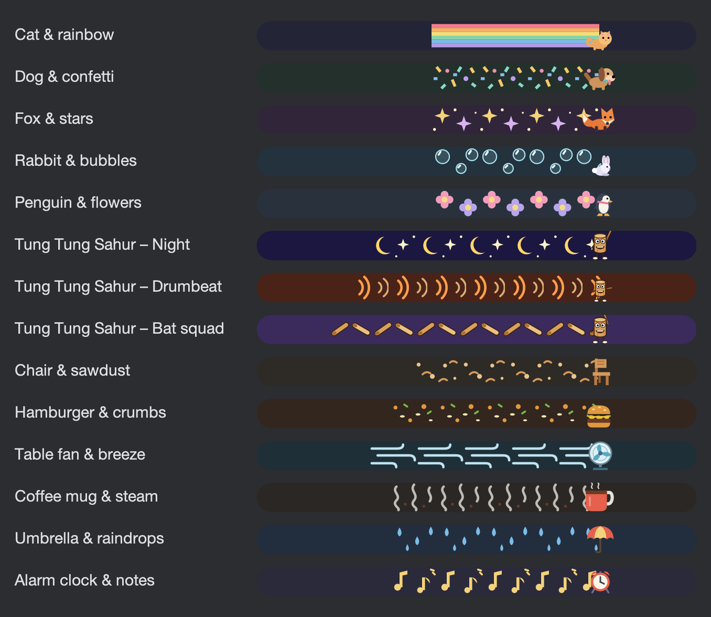
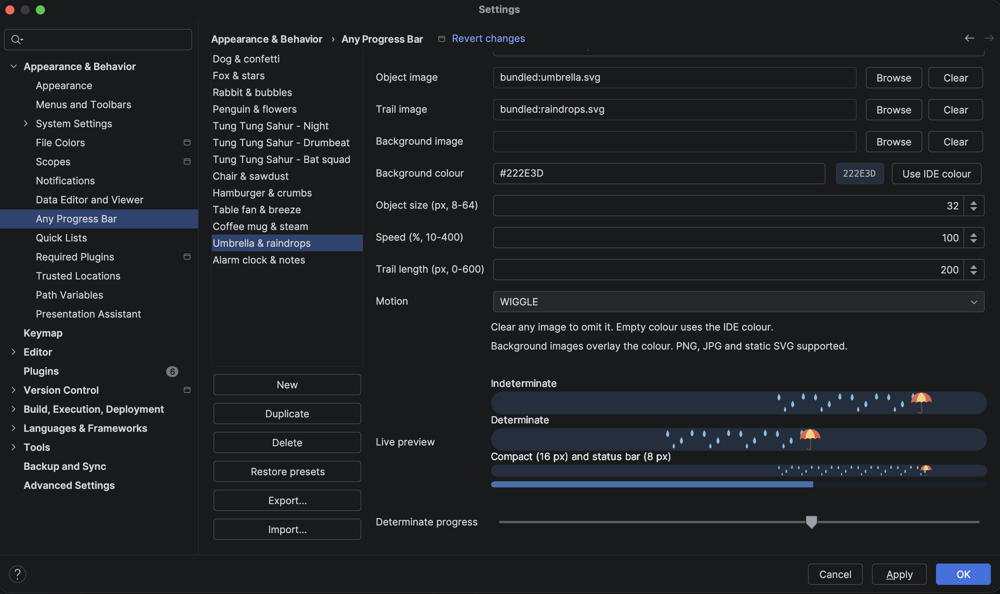

# Any Progress Bar

[](https://plugins.jetbrains.com/plugin/35163-any-progress-bar)
[](https://plugins.jetbrains.com/plugin/35163-any-progress-bar)

An IntelliJ IDEA plugin that replaces the standard progress bar with animated,
themeable ones. It ships with eight presets (animal and Tung Tung Sahur themes)
and includes an in-IDE editor for creating your own designs from PNG, JPG or SVG images.

> Inspired by the **Ultimate Progress Bar** plugin. This is an independent
> implementation and contains no code or assets from that project.

## Presets



**Animals**

| Animal | Trail | Motion |
|---|---|---|
| Cat | Rainbow | Bounce |
| Dog | Confetti | Wiggle |
| Fox | Stars | Glide |
| Rabbit | Bubbles | Bounce |
| Penguin | Flowers | Wiggle |

**Character themes**

| Theme | Object | Trail |
|---|---|---|
| Tung Tung Sahur - Night | log character, bat raised | moons and stars |
| Tung Tung Sahur - Drumbeat | log character, bat forward | drum sound rings |
| Tung Tung Sahur - Bat squad | log character, bat on shoulder | mini bats |

The Tung Tung Tung Sahur character is an original drawing of an internet meme character.

## Installation

Requires **IntelliJ IDEA 2026.1 (build 261) or newer**.

### From the JetBrains Marketplace (recommended)

In the IDE, open **Settings > Plugins > Marketplace**, search for **Any Progress Bar**,
click **Install** and restart the IDE. The plugin is also available on its
[Marketplace page](https://plugins.jetbrains.com/plugin/35163-any-progress-bar).

### From a release file

1. Download `any-progress-bar-<version>.zip` from the repository's **Releases** page,
   or [build it from source](#building).
2. In the IDE, open **Settings > Plugins > gear icon > Install Plugin from Disk...**
   and select the zip file. Do not unzip it.
3. Restart the IDE.

When upgrading from an earlier version, new presets are added to the library once and
custom designs are preserved.

## Usage

Open **Settings > Appearance & Behavior > Any Progress Bar**.



- Select a design from the list and click **Apply** to make it the active one.
- **New** and **Duplicate** create a design; **Delete** removes one.
- **Export...** saves a design, including its images, as a shareable `.apbdesign` file;
  **Import...** adds one to the library.
- Add an object image, a repeating trail image and/or a background image.
- Set a background colour with the colour picker or as `#RRGGBB`, or use the IDE colour.
- Adjust object size, speed, trail length and motion.
- The preview shows indeterminate and determinate progress at several bar heights.
- **Restore presets** resets the library to the built-in presets after confirmation.
- Clear **Enable custom progress bars** to return to the IDE's default rendering.

Every image layer is optional. Backgrounds stretch across the bar, objects keep their
aspect ratio, and trails tile behind the object. Transparent PNG or SVG files work best
for objects and trails.

### Motion types

| Motion | Effect |
|---|---|
| Glide | Moves steadily along the bar. |
| Bounce | Squashes and stretches vertically. |
| Wiggle | Rocks from side to side. |
| Hop | Jumps up and down while travelling. |
| Spin | Rotates continuously. |
| Pulse | Grows and shrinks. |
| Bob | Floats gently up and down. |
| Ping-pong | Indeterminate bars travel back and forth instead of looping. |

## Image support and limits

- PNG, JPG/JPEG and **static SVG**. SVG scripts, interactivity and SVG animation are
  not supported; motion is provided by the plugin.
- SVGs must be self-contained. Linked images, stylesheet imports, scripts and document
  type declarations are rejected, while fragment references such as `url(#gradient)` work.
  SVGs are limited to 5000 elements and 32 levels of nesting.
- Files may be up to 10 MB. Raster images may be up to 8192 px per side and 16 megapixels.
- Imported images are copied to `<IDE config directory>/any-progress-bar/assets`, so the
  originals can be moved or deleted afterwards. Settings are stored in
  `any-progress-bar.xml` and are local to that IDE configuration.

## Scope and troubleshooting

Horizontal Swing progress bars use the selected design. Vertical bars and views that do
not use `JProgressBar` keep the standard rendering. Determinate bars follow real
completion, and indeterminate bars loop at the configured speed. Bars shorter than 12 px
are drawn as a plain fill, because artwork is not legible at that size. Animation pauses
automatically for bars that are idle, hidden or in a minimized window.

If an image is missing or unreadable, the plugin shows a notification and skips only that
layer; the rest of the design is still used. Replace or clear the image in the settings.
If the design itself is invalid, the IDE's standard progress bar is used instead.

Do not enable another progress bar replacement plugin at the same time.

## Building

Requires **JDK 21 or newer**. The Gradle wrapper downloads all other dependencies,
including the IntelliJ IDEA 2026.1 SDK, so the first build can take a while.

```sh
./gradlew test                         # run the tests
./gradlew buildPlugin                  # build/distributions/any-progress-bar-<version>.zip
./gradlew verifyCompatibilityMetadata  # build the plugin and validate its descriptor
./gradlew runIde                       # start a sandbox IDE with the plugin loaded
```

The plugin declares `since-build="261"` and no upper build limit, so newer IDE versions
are not blocked at install time. Changes to the IDE API in future releases may still
require plugin updates. `verifyCompatibilityMetadata` validates this in the packaged zip.

### Adding a preset

1. Add the SVG files to `src/main/resources/art/`.
2. Add an entry to `Design.themePresets()` in
   `src/main/java/dev/anyprogressbar/Design.java`.
3. Run `./gradlew test`.

Private presets can also be listed in an optional `src/main/resources/art/brand/presets.tsv`
(see `Design.optionalPresets()`). That folder is git-ignored and excluded from builds by
default; pass `-PlocalBuild` (`./gradlew buildPlugin -PlocalBuild`) to include it in a
local build.

## Releasing

Releases are published by GitHub Actions.

1. Update `version` in `build.gradle.kts` and add an entry to `CHANGELOG.md`.
2. Push to `main`.
3. When the CI build passes and no release exists for that version yet, the workflow
   creates the `v<version>` tag and publishes a GitHub release with the plugin zip attached.

Pushes that do not change the version do not create a release. A release can also be
created manually by pushing a `v<version>` tag, which runs the **Release** workflow; the
tag must match the project version.

## Project layout

```
src/main/java/dev/anyprogressbar/   plugin code (painter, animation clock, settings, editor UI)
src/main/resources/art/             bundled SVG artwork
src/main/resources/META-INF/        plugin descriptor and icons
src/test/java/                      unit and IDE integration tests
docs/                               screenshots and the improvement backlog
```

## License

[MIT](LICENSE) © Mikael Broström
